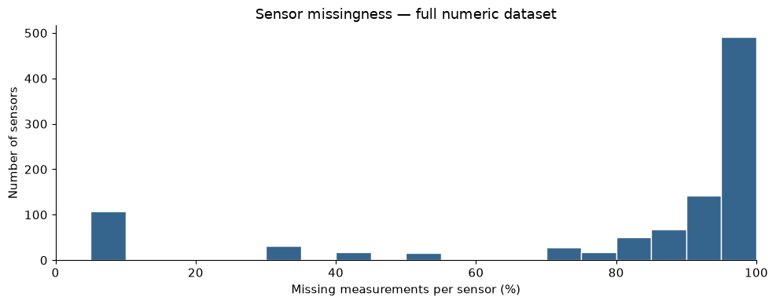

# Bosch Production Quality: Data Cleaning and Defect Prediction

[](https://github.com/Asabrax/bosch-production-quality/actions/workflows/tests.yml)

An industrial data-science project investigating **structured missingness, timestamp quality and credible defect screening** across 1,183,747 manufactured parts. Only 6,879 parts are defective (about 0.58%), making data-quality decisions and evaluation design more useful than accuracy alone.

**Both active notebooks have been executed on the full local datasets.** The project includes 19 synthetic tests and automated checks that require no competition data. All model results remain exploratory because this dataset informed earlier feature choices and test-set inspection.

Start with [the numeric investigation](explore.ipynb), then [the date and chronological-validation extension](date_analysis.ipynb). For a quick explanation, use the [five-minute interview walkthrough](docs/interview_walkthrough.md).

## Three findings

1. **Missing measurements contain structure worth preserving.** Numeric sensors are 81.08% missing on average. Selected within-station sensors have identical masks, while two S0/S1 sensors with similar missing percentages disagree on 1,642 parts. Availability can be a production-route proxy, though the mechanism is not established.
2. **A correct join does not imply complete information.** All numeric/date IDs match one-to-one, yet 582 parts have no recorded timestamps. Another 25,647 parts cross the chosen temporal boundaries. They remain in the quality analysis and are excluded only from the chronological experiment.
3. **Random-split performance did not carry over to later-time evaluation.** In the fixed date experiment, the selected model achieved 6.60% AP on the random split and 1.66% AP chronologically. The populations and defect prevalence differ, so this is a generalization warning, not a controlled estimate of leakage.



*Full numeric run: 968 sensors, 1,183,747 parts. Mean sensor missingness is 81.084898%; 634 sensors exceed 90%. Sparsity is a diagnostic, not an automatic deletion rule. [Figure provenance](docs/figures/README.md).*

## Cleaning decisions

| Issue | Evidence | Treatment | Why / validation |
|---|---|---|---|
| Structured missingness | Shared within-station masks; differing route coverage | Retain NaNs and create per-part/station counts | Avoid deleting route information; do not equate missingness with zero |
| Extreme sensor values | IQR diagnostics flag unusual recorded values | Investigate and retain; no automatic clipping/removal | A statistical outlier is not proof of a measurement error |
| Identity and schema integrity | Unique-ID/schema checks; all full-file IDs match | Reject duplicates or unexpected schema; validate a one-to-one join | Prevent duplicated parts, silent schema changes and join inflation |
| Unmatched IDs | Zero in the full files; synthetic tests cover mismatches | Preserve numeric rows and report both unmatched directions | An inner join must not silently discard parts |
| Missing timestamps | 582 parts have no recorded dates | Keep unknown ranges; exclude only from chronology | Unknown time must not be replaced by time zero |
| Temporal overlap | 23,179 train and 2,468 validation parts cross the next boundary | Save IDs/reasons and exclude from temporal fitting/validation | Keep recorded observation ranges before the next partition |
| Learned preprocessing and selection | Historical focus stations used all labels | Select focus stations on train only; fit tree imputation inside a pipeline | Keep validation/evaluation labels out of fitting and supervised selection |

Raw measurements, legitimate zeros, sparse sensors and all-missing parts are preserved. HGB uses NaNs directly; tree comparisons involving sensor values use training-fitted median imputation and missing indicators. [Detailed audit](docs/audit.md).

## Model evaluation

The operational example is inspecting the highest-risk **1% of parts**. This is an illustrative capacity, not a verified factory requirement. AP evaluates the ranking; precision and recall at capacity describe the inspection workload and the defects detected. Scores are not calibrated probabilities, and costs are unavailable.

These are **newly executed full-file experiments**, with different feature sets, selection procedures and evaluation populations:

| Exploratory evaluation | Parts / defects | Prevalence | AP | Precision at ~1% | Recall at ~1% |
|---|---:|---:|---:|---:|---:|
| Numeric notebook — selected HGB | 236,750 / 1,376 | 0.5812% | **4.8740%** | 8.7838% | 15.1163% |
| Date extension — random, common cohort | 231,504 / 1,364 | 0.5892% | **6.6006%** | 10.5354% | 17.8886% |
| Date extension — chronological, overlap-purged | 236,634 / 964 | 0.4074% | **1.6582%** | 4.7740% | 11.7220% |

The numeric run selected 50 station counts plus 14 sensor values from training-selected stations, with HGB using 7 leaves and learning rate 0.1. Validation AP was 5.6112%; selection preceded evaluation. At 1% capacity, it inspected 2,368 parts and found 208 defects.

The date extension compares a fixed HGB on numeric counts versus counts plus five global date summaries, selecting the feature set on validation AP separately for each split strategy. Both selected the date-augmented candidate. The chronological validation difference was small and has no uncertainty interval; this is not proof of a stable date-feature benefit.


*Different evaluation populations: random prevalence 0.5892%, chronological prevalence 0.4074%. At approximately 1% capacity, chronological evaluation detects 113 of 964 defects among 2,367 inspected parts. Prior exploration, unknown label timing and different populations limit interpretation. [Exact aggregate results and run hashes](docs/results.json).*

**Historical reference only:** the archived notebook reported 5.42% validation AP and 4.35% test AP with a different configuration. Those historical experiments were not rerun and are not substituted for the results above. The [unchanged original notebook](archive/explore_original.ipynb) and [audit](docs/audit.md) preserve their provenance.

## Method

The numeric notebook follows eight CRISP-DM sections, from business understanding through limitations. It retains the Decision Tree and HGB model families, the original seed-42 stratified 64/16/20 split sequence, and the small HGB parameter grid. Five declared feature sets produce 35 candidates; validation AP chooses the model. The full run selected focus stations S32/S33/S34/S31 using training labels only, replacing the historical handpicked S32/S33/S34/S24 list.

Total measurement count, all station counts, selected values and sensor-presence indicators are generated consistently. The original station-combination definition is preserved:

```python
S32_only = ((L3_S32_count > 0) & (L3_S33_count == 0)).astype('uint8')
```

It means numeric S32 recorded and numeric S33 absent, not absence of every other station. It is generated for analysis and excluded from all default model candidates, consistently with the original saved models.

The date extension streams wide inputs in chunks, joins on unique IDs, keeps timestamp ties together, and purges earlier parts whose recorded ranges cross the next temporal boundary. Its random comparator uses the same retained cohort. Dates remain in their supplied numeric units; earliest/latest time and their difference are **recorded ranges**, not certified factory processing durations. [Date design and results](docs/date_analysis.md).

## Reproduce

Use Python **3.14.4** and run from the repository root. With `uv` installed:

```bash
uv venv --python 3.14.4 .venv
uv pip install --python .venv/bin/python -r requirements.lock
source .venv/bin/activate
python -m pytest -q
```

Obtain `train_numeric.csv` and `train_date.csv` from the [Bosch competition data page](https://www.kaggle.com/competitions/bosch-production-line-performance/data), following Kaggle's access terms. Place both in `data/`, or set `BOSCH_DATA_PATH` and `BOSCH_DATE_PATH`. No datasets are included in the repository.

Run the full notebooks:

```bash
BOSCH_NROWS=0 python -m jupyter nbconvert \
  --execute --to notebook --inplace explore.ipynb --ExecutePreprocessor.timeout=-1
BOSCH_DATE_NROWS=0 python -m jupyter nbconvert \
  --execute --to notebook --inplace date_analysis.ipynb --ExecutePreprocessor.timeout=-1
```

Use `BOSCH_NROWS=20000` or `BOSCH_DATE_NROWS=20000` for prefix smoke tests, not representative performance estimates. The full numeric frame alone uses about 4.28 GiB; parsing/fitting require additional RAM. Models run sequentially with four threads. See [reproduction, memory and inference instructions](docs/reproduction.md) for details.

Run manifests, split IDs and models are written to ignored `artifacts/` directories. The public [results receipt](docs/results.json) includes aggregates and source hashes only. [The export script](scripts/export_portfolio_results.py) refreshes the receipt and extracts the existing figures after new full runs; it does not fabricate or recalculate model scores.

## Verification and limits

- Numeric notebook: full 1,183,747-row execution on **2026-10-30**, all 35 candidates, 13 sequential code cells and seven rendered figures.
- Date notebook: full-file execution on **2026-10-29**, four model fits, nine sequential code cells and three rendered figures.
- **19 synthetic tests** cover feature counts, schemas, inference, selection isolation, split membership, temporal overlap, joins and metrics. [GitHub Actions](https://github.com/Asabrax/bosch-production-quality/actions/workflows/tests.yml) runs these tests and notebook structure/syntax checks without downloading competition data. It does not certify full-data execution or scientific conclusions.

Historical target-informed exploration and repeated test inspection prevent independent-holdout claims. Recorded times do not establish label availability, and random/chronological comparisons use different populations. Uncertainty intervals, inspection costs, product/batch grouping and operational prediction timing remain unresolved.

Before an early-warning or deployment claim, define the prediction event, reconstruct features available at that time, establish label maturity and evaluate once on genuinely new parts after freezing decisions. Final timestamps, full-route counts and recorded spans may contain future information for an earlier screening point.

## Repository guide

| File | Purpose |
|---|---|
| [explore.ipynb](explore.ipynb) | Full numeric investigation and declared model comparison |
| [date_analysis.ipynb](date_analysis.ipynb) | Date quality, join audit and chronological experiment |
| [bosch.py](bosch.py), [bosch_dates.py](bosch_dates.py) | Reusable, memory-conscious transformations and evaluation |
| [tests/](tests/) | Synthetic checks; no competition data required |
| [docs/audit.md](docs/audit.md) | Preservation, leakage findings and execution evidence |
| [docs/date_analysis.md](docs/date_analysis.md) | Temporal assumptions and detailed results |
| [docs/interview_walkthrough.md](docs/interview_walkthrough.md) | Five-minute explanation and follow-up questions |
| [docs/reproduction.md](docs/reproduction.md) | Environment, commands, provenance and inference |
| [archive/explore_original.ipynb](archive/explore_original.ipynb) | Unmodified historical work and saved outputs |
