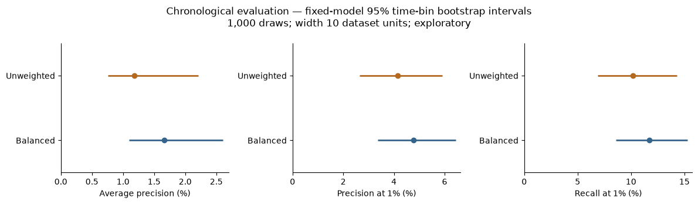

# Bosch Production Quality: Data Cleaning and Defect Prediction

A reproducible investigation of **structured missingness, timestamp quality, and defect screening** across 1,183,747 manufactured parts. Just 0.58% are defective. The project explains cleaning decisions, prevents new supervised feature-selection leakage, and tests how conclusions change under chronological evaluation.

## Results at a glance

Full-data executions; all results are **exploratory**, because earlier analysis used this dataset. Precision and recall refer to inspecting the highest-risk approximately 1% of parts.

| Experiment | AP | Precision at 1% | Recall at 1% | Defects found |
|---|---:|---:|---:|---:|
| Numeric notebook — selected HGB | 4.87% | 8.78% | 15.12% | 208 / 1,376 |
| Date features, random — balanced | 6.60% | 10.54% | 17.89% | 244 / 1,364 |
| Date features, random — unweighted | 6.68% | 11.05% | 18.77% | 256 / 1,364 |
| Date features, chronological — balanced | 1.66% | 4.77% | 11.72% | 113 / 964 |
| Date features, chronological — unweighted | 1.19% | 4.14% | 10.17% | 98 / 964 |

The date benchmark changes **only class weighting**, retaining the saved features, training rows, and HGB settings. Random and chronological evaluations have different populations and prevalence (0.589% versus 0.407%); their gap does not isolate leakage or drift. The numeric experiment uses a different selection procedure.

*Chronological evaluation: 236,634 parts, 964 defects. Conditional 95% percentile intervals from 1,000 paired time-bin bootstrap draws; primary bin width 10 dataset units. Widths 5 and 20 are reported as sensitivity checks. These intervals exclude retraining uncertainty and future drift. [Exact results and assumptions](docs/benchmark.md).*

See the [inspection-capacity trade-off](docs/capacity.md) for precision, recall, false alarms, and defects missed at 1%, 2%, 5%, and 10%, reported separately on validation and exploratory evaluation. Increasing capacity changes workload, not ranking quality.

## Three findings

1. **Missingness deserves investigation before deletion.** Numeric sensors are 81.08% missing on average. Shared within-station masks suggest route structure; similar missing percentages alone do not prove identical coverage. Preserve NaNs, legitimate zeros, and unusual measurements unless evidence supports a correction.
2. **Complete ID matching does not mean complete time information.** All numeric/date IDs match one-to-one, but 582 parts lack timestamps. Another 25,647 cross temporal boundaries. Preserve them in quality analysis and explicitly exclude them from the chronological experiment.
3. **A higher point estimate is not a confirmed improvement.** The unweighted chronological HGB achieves 1.19% AP versus 1.66% for balanced HGB. The paired 95% intervals include zero for AP, precision, and recall at every tested bin width. The observed balanced-model advantage is not established under this uncertainty analysis.

## Explore and reproduce

- [Numeric notebook](explore.ipynb): cleaning, feature engineering, and 35 model candidates.
- [Date notebook](date_analysis.ipynb): timestamp audit, joined features, and chronological splits.
- [Benchmark notebook](benchmark_analysis.ipynb): class-weight comparison and paired uncertainty analysis.
- [Detailed methodology](docs/methodology.md), [leakage audit](docs/audit.md), and [five-minute walkthrough](docs/interview_walkthrough.md).

Use Python 3.14.4 and `requirements.lock`; [reproduction instructions](docs/reproduction.md) cover environment setup, data acquisition, notebook order, and memory. Raw competition files, models, predictions, and split IDs stay local. The [22 synthetic tests](tests/) and GitHub Actions check software behavior and notebook structure without competition data.

## Limits

There is **no genuinely independent holdout**, and prediction-time feature availability is unverified. Full-route counts and final timestamps may contain future information for early screening. The illustrative 1% inspection capacity is not a factory requirement; costs and label timing are unknown. Time-bin bootstrap assumptions do not remove these limits.

Historical scores remain reference values in the [unchanged archive](archive/explore_original.ipynb). New results and provenance are recorded separately in the [original run receipt](docs/results.json) and [benchmark receipt](docs/benchmark_results.json).
