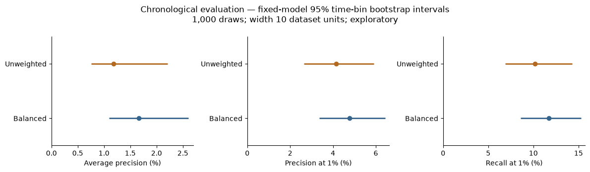

# Bosch Production Quality: Data Cleaning and Defect Prediction

An investigation of **structured missingness, timestamp quality, and defect screening** across 1,183,747 manufactured parts. Just 0.58% are defective. The workflow uses training-only supervised feature selection and compares random with chronological evaluation.

## Results at a glance

These runs use the full dataset. Earlier exploration informed the experiments, so the results are **exploratory**. Precision and recall refer to inspecting the highest-risk approximately 1% of parts.

| Experiment | AP | Precision at 1% | Recall at 1% | Defects found |
|---|---:|---:|---:|---:|
| Numeric notebook — selected HGB | 4.87% | 8.78% | 15.12% | 208 / 1,376 |
| Date features, random — balanced | 6.60% | 10.54% | 17.89% | 244 / 1,364 |
| Date features, random — unweighted | 6.68% | 11.05% | 18.77% | 256 / 1,364 |
| Date features, chronological — balanced | 1.66% | 4.77% | 11.72% | 113 / 964 |
| Date features, chronological — unweighted | 1.19% | 4.14% | 10.17% | 98 / 964 |

The date benchmark varies **class weighting** while holding features, training rows and HGB settings fixed. Random and chronological splits differ in population and prevalence (0.589% versus 0.407%), so their AP gap reflects several changes together. The numeric experiment uses a separate selection procedure.

*236,634 chronological evaluation parts, including 964 defects. The 95% intervals use 1,000 paired time-bin bootstrap draws at width 10, with widths 5 and 20 as sensitivity checks. They describe sampling uncertainty for the fitted models; retraining and future drift are outside their scope. [Details](docs/benchmark.md).*

See the [inspection-capacity trade-off](docs/capacity.md) for precision, recall, false alarms, and defects missed at 1%, 2%, 5%, and 10%, reported separately on validation and exploratory evaluation. Increasing capacity changes workload, not ranking quality.

## Three findings

1. **Missingness carries structure.** Numeric sensors are 81.08% missing on average. Shared within-station masks suggest route structure, while similar missing percentages can hide different coverage. Raw missing values, zeros and extreme measurements are retained; model-specific imputation uses training data.
2. **Timestamp coverage affects chronological evaluation.** All numeric/date IDs match, but 582 parts lack timestamps and 25,647 cross temporal boundaries. They remain in quality analysis and are excluded from the chronological experiment.
3. **The class-weighting result is uncertain.** Balanced HGB scores 1.66% chronological AP versus 1.19% for unweighted HGB. Paired 95% intervals for AP, precision and recall differences include zero at every tested bin width.

## Explore and reproduce

- [Numeric notebook](explore.ipynb): cleaning, feature engineering, and 35 model candidates.
- [Date notebook](date_analysis.ipynb): timestamp audit, joined features, and chronological splits.
- [Benchmark notebook](benchmark_analysis.ipynb): class-weight comparison and paired uncertainty analysis.
- [Detailed methodology](docs/methodology.md), [leakage audit](docs/audit.md), and [project walkthrough](docs/project_walkthrough.md).

Use Python 3.14.4 and `requirements.lock`; [reproduction instructions](docs/reproduction.md) cover environment setup, data acquisition, notebook order, and memory. Raw competition files, models, predictions, and split IDs stay local. The [22 synthetic tests](tests/) and GitHub Actions check software behavior and notebook structure without competition data.

## Limits

Earlier exploration used the evaluation data, so an independent future cohort is still needed. Early screening also requires checking when features become available: full-route counts and final timestamps may arrive after the intended prediction point. The 1% inspection capacity is an assumed budget; factory costs and label timing remain unknown.

Historical scores remain reference values in the [unchanged archive](archive/explore_original.ipynb). New results and provenance are recorded separately in the [original run receipt](docs/results.json) and [benchmark receipt](docs/benchmark_results.json).
